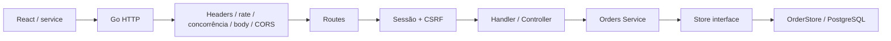

# Como o código funciona

O Model representa os dados e suas regras, os handlers são os controllers HTTP e a View é o SPA React. Os casos de uso de pedidos ficam entre controller e repositório para manter transações e regras separadas do transporte. O catálogo e a autenticação preservam seus models existentes; a separação pode ser aplicada aos demais módulos conforme crescerem.

`main.go` é a raiz de composição: carrega/valida configuração, abre um pool de conexões, verifica o schema, instancia models, service e handlers e inicia `http.Server`. As dependências são valores explícitos, sem banco global. `*sql.DB` é um pool seguro para uso concorrente, não uma conexão única. O pool padrão possui no máximo quatro conexões; pode ser ajustado dentro dos limites validados.

`cmd/dbsetup` é uma ferramenta de instalação separada. `internal/bootstrap` usa os SQLs embutidos de `db/embed.go`, cria a base se ausente, serializa preparação por advisory lock, aplica migrations com checksum e executa seeds idempotentes. Nunca roda no caminho de uma requisição HTTP. O runtime não recebe credencial administrativa. `internal/config` compartilha a leitura segura de .env entre comandos, sem executar shell.

`internal/server` concentra a política HTTP/TLS e envolve o listener TCP com limites globais e por IP. Um wrapper de conexão libera o contador exatamente uma vez ao fechar (`sync.Once`), inclusive em timeout de header. Assim há limites antes dos middlewares, para sockets que ainda não enviaram uma requisição completa. Nenhum desses componentes depende de kernel Windows ou Docker.

## Uma compra passo a passo

1. `ProductCard` abre o modal global via Zustand. Confirmar adiciona IDs/opções/quantidades ao carrinho persistido; preços/autorizações continuam no servidor.
2. `/cart` confere produtos em uma consulta limitada, seleciona endereço salvo da sessão e chama `service/orders.ts` com address_id e cupom opcional. Valibot valida o payload, o serviço recupera CSRF e usa `callApi`. `/carrinho` redireciona para `/cart`.
3. `callApi` envia JSON a `/api/orders`, cookie por mesma origem e `X-CSRF-Token`. Durante desenvolvimento, o Vite encaminha a chamada ao Go.
4. Os middlewares limitam tráfego, concorrência, headers/corpo e origem. A sessão consulta hash, validade, revogação e status do usuário; injeta a identidade no contexto. Para escrita, compara CSRF em tempo constante.
5. `OrderHandler.Create` decodifica JSON estrito e cria contexto com timeout de cinco segundos. O service valida UUID do endereço, cupom, opções, duplicatas, até 50 combinações e 100 unidades somadas. O JSON não aceita preço, dono ou endereço avulso.
6. `OrderStore.Create` abre uma transação. `defer tx.Rollback()` garante rollback em qualquer retorno antecipado; após `Commit`, esse rollback não altera os dados já confirmados.
7. A transação lê endereço ativo do dono com FOR SHARE e copia a entrega. A FK composta também impede associar outro dono. Insere o pedido e ordena UUIDs antes de atualizar produtos. `UPDATE ... stock_quantity >= quantidade RETURNING ...` bloqueia produtos contra overselling. IDs inativos, opções divergentes ou estoque insuficiente abortam tudo.
8. Nome, SKU, preço e opções vêm do banco para snapshots. PostgreSQL calcula com `NUMERIC`, aplica GREEN10 (10%, até R$ 50), atualiza totais e grava auditoria na mesma transação. Dinheiro sai em string decimal. Variações compartilham o estoque/preço do produto.
9. O servidor confirma e retorna `201` com `Location`. O React limpa o carrinho, invalida caches e navega para o detalhe.

Não há repetição automática de POST: uma falha de rede pode ocorrer depois do commit. Antes de repetir uma compra incerta, consulte seus pedidos. Uma futura integração financeira deve adicionar chave de idempotência persistida.

## Leitura, edição e cancelamento

A lista é paginada e filtra pelo dono autenticado; contém resumos com `items: []`. O detalhe carrega snapshots completos. Filtro e total da lista usam o mesmo snapshot de uma consulta, inclusive em página vazia.

Editar e cancelar primeiro usam `SELECT ... FOR UPDATE` no pedido, sempre com `user_id` no `WHERE`. Aceitam apenas `pending`, sem pagamento pendente/autorizado/pago/reembolsado nem qualquer remessa. O lock impede cancelamentos duplos. Cancelar devolve estoque em ordem de UUID e muda o status para `cancelled`; mantém pedido, itens e auditoria. Usuário que tenta acessar UUID alheio recebe `404`.

Futuros serviços de pagamento e envio precisam obter esse mesmo lock antes de criar registros ou transicionar o pedido. Não adicione um endpoint genérico para o cliente definir status, frete ou total.

## Go para quem está começando

- Uma `struct` reúne dados; tags como `json:"shipping_address"` definem nomes no JSON.
- Métodos com receiver (`func (s Service) Create`) pertencem ao tipo. Uma interface lista métodos e é satisfeita implicitamente; `OrderStore` implementa `Store` sem declarar isso.
- `error` é um retorno normal. `errors.Is` distingue conflito/não encontrado sem comparar mensagens. Erros de validação retornam 400; erros de banco ficam nos logs e viram mensagem genérica.
- `context.Context` propaga cancelamento e deadline da requisição ao banco. Não reutilize contexto cancelado em outra requisição.
- `defer` executa ao sair da função. Ele libera transação, timer ou semáforo mesmo em erro.
- Goroutines executam concorrentemente. Mutex protege o mapa do rate limiter; um canal com capacidade fixa funciona como semáforo. Excesso recebe 503 imediatamente.
- `http.ServeMux` escolhe rota por método e caminho. `{id}` é lido por `r.PathValue("id")`.

## SPA e chunks

`routes/router.tsx` registra páginas com `lazyRouteComponent(() => import(...))`. O `import()` dinâmico produz chunks no build do Vite; nenhum plugin adicional é necessário. O shell, as stores Zustand e o modal de carrinho na raiz continuam compartilhados.

O Go serve arquivos do `SPA_DIR`; navegação HTML em `/pedidos/...` recebe `index.html`. Arquivos ausentes e qualquer `/api/*` desconhecida recebem 404, nunca o fallback React. Não há listagem de diretórios ou publicação de dotfiles.

Os caches privados de pedidos/endereços incluem ID do usuário e são removidos em login/logout. Sessão fica em cookie HttpOnly, CSRF só em memória. Carrinho persiste somente IDs/opções/quantidades no localStorage validado e limitado a 16 KiB. Veja [UI-FLOWS.md](../../ecommerce-front-spa/docs/UI-FLOWS.md) para componentes, formulários com etapas/arrays e proteção do armazenamento.

## Agenda e migrations

`AddressHandler → addresses.Service → AddressStore` separa HTTP, validação e SQL. Toda consulta filtra usuário da sessão. Salvar usa lock FOR NO KEY UPDATE por usuário, mantendo até 20 endereços ativos sob concorrência, compatível com as verificações de FK das compras. DELETE arquiva: a FK e o snapshot dos pedidos permanecem. Editar agenda não muda pedidos; trocar entrega exige PUT no pedido pendente.

Migrations 003/004 são transacionais pelo dbsetup. Pedidos legados recebem endereços arquivados gerados dos snapshots, sem lotar a agenda ativa. Opções vazias mantêm pedidos antigos válidos. Nova unicidade permite o mesmo produto com escolhas diferentes em um pedido. O startup confere também as colunas novas e orienta executar dbsetup se faltarem.

## Perfil sensível e cartões

A migration 005 acrescenta `user_profiles` (1:1), `credit_cards` (N:1), FK composta cartão/usuário e snapshot mascarado nos pedidos novos. O domínio `billing` recebe interfaces de persistência e reautenticação; `secrets.Vault` encapsula AES-GCM/HMAC com chave externa. `BillingHandler` atende os contratos privados sem conhecer SQL. A composição permanece em main, sem banco ou chave global e sem reescrever os módulos anteriores.

O startup confere o canário criptográfico para recusar chave errada. Novas compras exigem CPF/telefone e cartão próprio/ativo/válido; pedidos antigos são preservados explicitamente como legados, sem inventar dados. O cartão é referenciado, não cobrado. Exclusão limpa ciphertexts e mantém somente o registro histórico mascarado. Leia [SENSITIVE-DATA.md](SENSITIVE-DATA.md) para diagramas, fluxo, contratos e avaliação do escopo da atividade.
