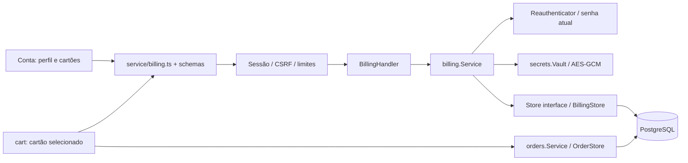

# Perfil sensível e cartões — arquitetura e segurança

Projeto acadêmico de Segurança de Sistemas. O autor está aprendendo Go; este documento explica as decisões e o fluxo entre React, handlers, serviços e PostgreSQL. Use somente dados fictícios no laboratório. O cadastro de cartão e seu vínculo ao pedido não fazem cobrança, não consultam banco emissor e não representam conformidade PCI DSS.

## Estrutura mantida

O monólito MVC comporta este incremento sem reescrita: o domínio novo fica em `internal/billing`, a criptografia em `internal/secrets` e a implementação PostgreSQL em `repositories/billing.go`. Handlers não conhecem SQL; serviços recebem interfaces pequenas para persistência e reautenticação. `main.go` compõe explicitamente as dependências, carrega a chave e verifica o banco antes de abrir o listener.



`billing.Store` oferece perfil, lista/cadastro/arquivamento de cartões. `Reauthenticator` desacopla o domínio da implementação bcrypt. `secrets.Vault` isola algoritmos e formato de cifra; usa somente a biblioteca padrão Go. Não foram adicionadas bibliotecas, serviços externos, Docker ou processos permanentes. O pool e os limites existentes continuam ativos.

## Dados e relacionamentos

| Tabela | Relação e finalidade |
| --- | --- |
| `users` | Identidade, login, nome e email existentes |
| `user_profiles` | 1:1 com usuário; CPF/telefone criptografados e máscaras para resposta |
| `credit_cards` | N:1 com usuário; número/titular criptografados, bandeira, final, validade, fingerprint interno e arquivamento |
| `orders` | Usuário + endereço + cartão próprio; FK composta impede usar cartão de outro dono |
| `data_key_checks` | Um canário criptografado, sem dado pessoal, para detectar chave errada no startup |

Há até 10 cartões ativos por usuário. Um lock `FOR NO KEY UPDATE` no usuário serializa a quota, assim como a agenda. Fingerprint HMAC por usuário impede cadastro duplicado do mesmo cartão ativo, sem guardar hash simples do número e sem correlacionar o cartão entre contas. O fingerprint nunca sai na API.

Novas compras exigem perfil completo e `credit_card_id` válido. A transação lê o cartão próprio, ativo e não expirado com `FOR SHARE`, reserva estoque e grava o pedido e os snapshots na mesma transação. A validade é verificada no momento de criar, em UTC, e também no cadastro. O snapshot do cartão contém apenas bandeira e quatro últimos dígitos; não contém número completo, titular, senha, CPF, telefone ou CVV.

Cartões são imutáveis: para trocar dados/validade, cadastre outro e exclua o anterior. A exclusão exige senha atual, arquiva o registro e limpa `number_cipher`/`holder_cipher`; a referência mascarada dos pedidos continua disponível. Não troca o cartão de pedidos já criados nem bloqueia seu cancelamento. Backups antigos ainda podem conter ciphertexts e precisam de retenção definida.

A migration 005 preserva pedidos legados sem fabricar cartão ou identidade. Apenas os anteriores recebem `card_required=false`; novas inserções têm default true e constraint de cartão/snapshot obrigatório. A flag não existe no JSON público. O detalhe exibe que pedidos antigos são anteriores ao cadastro de cartões. CPF/telefone de contas antigas devem ser preenchidos pelo próprio usuário.

## Criptografia e chave

CPF, telefone, PAN (número completo) e nome do titular são protegidos com **AES-256-GCM**, nonce aleatório gerado por `cipher.NewGCMWithRandomNonce` e dados adicionais autenticados (AAD). O AAD inclui finalidade, usuário e campo; cartões também incluem fingerprint. Copiar ciphertext para outro usuário/campo ou alterar bytes falha na autenticação ao abrir. O envelope começa com versão 1 para permitir evolução explícita.

Chaves independentes de AES e HMAC são derivadas com HKDF-SHA-256 e contextos distintos da chave mestra. Não há chave padrão, chave no código ou fallback para texto puro. `DATA_KEY_FILE` contém uma chave aleatória de 32 bytes codificada em Base64. `cmd/keygen` usa crypto/rand, cria arquivo com exclusividade e nunca sobrescreve um existente.

No startup, `database.BindDataKey` verifica um canário autenticado no banco. A primeira instalação o cria sob advisory lock. Uma chave diferente, ou ausência do canário com dados já existentes, faz o servidor recusar startup. O runtime só precisa SELECT/INSERT nessa tabela, não UPDATE/DELETE.

Desenvolvimento, partindo de `ecommerce-api-go`:

```sh
go run ./cmd/dbsetup
go run ./cmd/keygen
# Opcional: DATA_KEY_FILE aponta para outro caminho protegido.
go run .
```

Gere a chave apenas na primeira instalação. Se o arquivo já existir, preserve-o. Faça backup da chave separado do backup do banco e restrinja acesso. Perder a chave impede recuperar o texto original. Trocar por outra chave de tamanho válido não é uma rotação: o servidor detecta divergência e recusa iniciar. Rotação futura exige ferramenta offline que autentique a cifra antiga, recriptografe CPF/telefone/PAN/titular, recalcule fingerprints/AAD e canário em transação, com backup e teste de restauração. Essa ferramenta de rotação ainda não está implementada.

No Linux, arquivo modo 600 e diretório 700, proprietário do serviço. No Windows, o arquivo também precisa de ACL restrita: os bits Unix 0600 sozinhos não comprovam a ACL NTFS. Não copie a chave para dist, assets, logs, Git ou cliente React. O guia Ubuntu foi atualizado com keygen e grants novos.

Esta escolha segue a [OWASP Cryptographic Storage](https://cheatsheetseries.owasp.org/cheatsheets/Cryptographic_Storage_Cheat_Sheet.html): minimização, criptografia autenticada, aleatoriedade criptográfica e chave separada dos dados. Criptografia em repouso não protege contra alguém que controla simultaneamente processo e chave.

## API e autorização

Todos os endpoints exigem a sessão existente. Escritas exigem CSRF/origem confiável. Além dos limites globais, as escritas de perfil/cartão compartilham 10 tentativas/minuto/IP e no máximo duas execuções simultâneas. CPF/telefone novos, cadastro de cartão e exclusão requerem `current_password`; erro de senha alimenta o lockout da conta. Não se cria uma nova sessão ao confirmar a senha.

Perfil/cartões exigem HTTPS. Em desenvolvimento, HTTP é permitido somente para cliente loopback; PRODUCTION=1 exige TLS até no loopback. O middleware não confia em X-Forwarded-Proto, e a implantação suportada usa TLS no próprio Go. Uma futura terminação externa precisa de topologia e confiança de proxy explícitas, não de liberação por header. Não exponha o Vite de desenvolvimento na rede da aula.

| Método | Contrato e resposta |
| --- | --- |
| GET `/api/profile` | `{complete,cpf_masked,phone_masked}`; incompleto retorna false e máscaras vazias |
| PUT `/api/profile` | `{cpf,phone,current_password}`; substitui ambos e responde somente máscaras |
| GET `/api/cards` | Array de até 10 `{id,brand,last4,exp_month,exp_year,created_at}` |
| POST `/api/cards` | `{number,holder_name,exp_month,exp_year,current_password}`; responde DTO mascarado |
| DELETE `/api/cards/{id}` | JSON `{current_password}`; 204 após arquivar/limpar ciphertexts |
| POST `/api/orders` | Acrescenta `credit_card_id` obrigatório ao contrato de criação existente |

Nenhum endpoint recebe `user_id` do cliente ou devolve PAN, titular completo, ciphertext, fingerprint ou senha. Não há GET por ID de cartão porque basta a lista limitada. Campos extras como `cvv`, `card_required` ou `status` são rejeitados pelo JSON estrito. CPF usa dígitos verificadores; telefone usa sintaxe brasileira com DDD e +55 opcional; cartão usa Luhn e bandeiras Visa/Mastercard/Amex. Essas verificações não provam identidade, propriedade do telefone ou autorização bancária.

Erros: input 400, sessão 401, senha atual inválida/bloqueio/CSRF 403, cartão alheio/arquivado/expirado no pedido 404, duplicidade de cartão ativo 409, transporte inseguro 426, taxa 429. O log do módulo registra somente a falha genérica, e auditoria guarda usuário, recurso e ação, sem payload sensível. Confirmação de senha reduz abuso de sessão roubada nas alterações sensíveis; não é MFA nem autorização de uma transação financeira real. Veja a [OWASP Transaction Authorization](https://cheatsheetseries.owasp.org/cheatsheets/Transaction_Authorization_Cheat_Sheet.html) antes de integrar um gateway.

## React e carrinho

`ProfilePanel` e `CardBook` ficam em Minha conta; `CardBook` também seleciona o cartão no checkout. `Form`, `Field` e `useForm` continuam responsáveis por noValidate, asteriscos e erros por campo. Os schemas ficam em `schemas/billing.ts`, os requests em `service/billing.ts`, e os tipos são inferidos dos schemas. Cartões expirados aparecem, mas não podem ser selecionados.

CPF, telefone, PAN e senha ficam somente no formulário transitório de envio. Não entram em Zustand, cookie, localStorage ou query de leitura. Mutations sensíveis ficam no editor, usam gcTime 0, não repetem automaticamente e são descartadas ao desmontar; isso reduz retenção, não garante apagar strings da memória do navegador. Queries recebem somente máscaras e usam chave por usuário. Logout/troca de conta cancelam e removem caches de profile/cards, além de endereços/pedidos. O carrinho persistido permanece com IDs de produtos/opções/quantidades: nem o cartão selecionado é persistido.

Não existe campo de CVV. O [PCI SSC esclarece que CVV não pode ser retido para cartões salvos](https://www.pcisecuritystandards.org/faqs/1280/), mesmo criptografado. Para pagamentos reais, substitua a captura local por campos hospedados/tokenização de um provedor apropriado e revise o escopo PCI com o provedor. O código atual não é uma integração de pagamento certificada.

## Avaliação do escopo da atividade

| Requisito | Situação concreta |
| --- | --- |
| Nomes, CPF, telefone e endereço | Nome/email existentes; CPF/telefone agora no perfil; vários endereços próprios |
| Cartões | Vários por usuário, protegidos e vinculados a novas compras; somente teste acadêmico |
| Login | Sessão PostgreSQL, cookie HttpOnly, CSRF, lockout e limites |
| Compra | Pedidos, estoque transacional, endereço/cartão próprios, snapshots e cancelamento |
| Venda e entrega | Catálogo/estoque e dados de entrega existentes; operação do vendedor, gestão de remessas/rastreio e gateway real ainda não foram implementados |
| Segurança OWASP | Controles documentados/testados; não se declara certificação ou imunidade a ataques |

Para ampliar venda/remessa, crie serviços de domínio e contratos próprios com autorização por seller/admin. Não exponha status/preço/dono como edição genérica do cliente. Reutilize o lock de pedido nas transições e teste autoria, pagamento/remessa e estoque. A arquitetura admite esses módulos sem reescrever o MVC.

Outros pontos ainda relevantes: MFA e recuperação de conta, verificação de telefone/email/identidade, idempotência persistida de compras, expiração de reservas, retenção/exclusão de dados e backups, rotação de chaves, monitoramento e mitigação de DDoS na rede. Nomes, emails e endereços existentes não foram migrados para criptografia de campo neste incremento; exigem proteção do banco/backups e uma avaliação de minimização/criptografia própria. A captura de cartão real, confirmação financeira ou conformidade regulatória exigiria outro escopo e provedor.

## Testes e limites da verificação

Testes unitários verificam CPF/telefone/Luhn/validade, reautenticação antes da persistência, nonce diferente, AAD de dono/campo, alteração de ciphertext, chave inválida e ausência de segredo no contrato. PostgreSQL descartável verifica criação/migração/idempotência, quota concorrente de cartões, cartão alheio/expirado/arquivado, FK, snapshots, exclusão com limpeza de ciphertext e startup com chave errada. HTTP exercita cookie/CSRF, senha incorreta, recusa de CVV, cadastro/lista/exclusão e pedido com cartão. Frontend testa schemas, validade e recusa de dados sensíveis na persistência do carrinho.

Execute os comandos de TESTING.md e npm test/lint/build. Inspeção visual manual: completar perfil, cadastrar dois cartões, confirmar erros de campo, selecionar no cart, criar pedido e excluir o cartão mantendo o histórico. Não havia navegador conectado neste ambiente; não foi executada inspeção visual, pagamento real, pentest externo nem teste em Ubuntu/Kali. O banco configurado da aplicação foi preservado; aplique dbsetup e gere/configure a chave antes de iniciar a versão nova.
