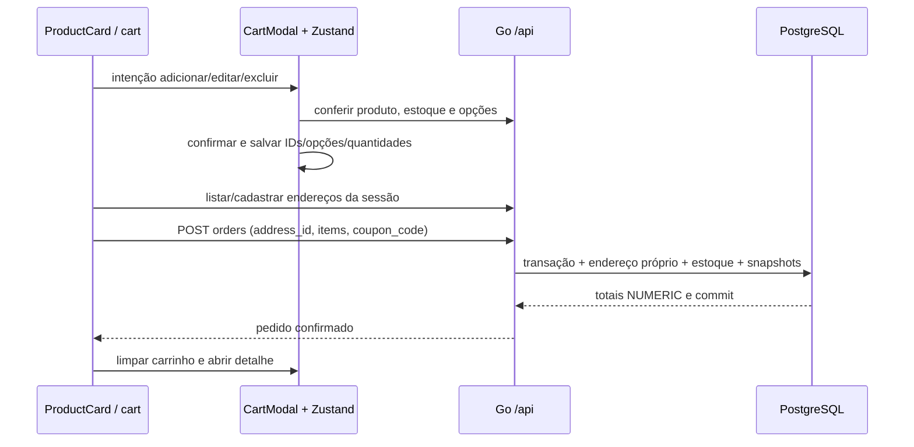

# Carrinho, endereços e formulários

O autor está aprendendo Go. Este guia conecta as intenções da View aos handlers, serviços e transações do monólito. Use os arquivos indicados para acompanhar cada etapa.

## Componentes e estado

- `src/App.tsx`: shell flexível, navegação e uma única instância de `src/CartModal.tsx` na raiz do React.
- `src/stores/cart-modal.ts`: store Zustand de intenção (`add`, `edit`, `remove`); não persiste dados do modal.
- `src/stores/cart-core.ts`: regras e persistência de itens; `stores/cart.ts` conecta a store ao React. O Cart Context foi removido.
- `components/common/Modal.tsx`: dialog nativo com Escape, foco, restauração do foco e bloqueio de scroll; usado também nos endereços e cancelamento.
- `components/common/promotions/PromotionSwiper.tsx`: carrossel próprio, sem dependência adicional; swipe horizontal, setas, pontos, autoplay, pausa em hover/foco e redução de movimento.
- `components/common/Button.tsx`: tons `add`, `danger`, `info`, `neutral`, `brand`. Ícones de exclusão usam vermelho; edição/informação usa azul; inclusão usa verde.
- `components/common/orders/OrderStatus.tsx`: rótulos de status. `utils/format.ts` associa a cor dos cards ao status; cancelados ficam vermelhos. O shell e `/pedidos` usam flex, e a navegação recebe `mt-auto` para permanecer no rodapé mesmo com poucos resultados.

`/cart` é a rota canônica; `/carrinho` redireciona para ela. Páginas continuam divididas em chunks por `lazyRouteComponent`/`import()` no router.

## Fluxo de compra



O modal de exclusão só precisa do item local e permite remover produtos que saíram do catálogo. Inclusão/edição consulta o produto atual e usa as escolhas cadastradas em `products.options`. O carrinho consulta até 50 IDs em **uma requisição**, evitando uma chamada por linha. Valores e estoque são estimativas até o servidor confirmar a compra. Durante a criação do pedido as alterações locais ficam bloqueadas para não apagar itens adicionados enquanto a resposta está em trânsito.

O cupom GREEN10 do carrossel funciona no backend: 10%, até R$ 50. Frete é zero na versão didática. Tipo/tamanho/cor são opções genéricas; nesta versão todas as variações usam o mesmo preço e estoque do produto.

## Persistência e validação

`greenstore-cart-v1` no localStorage contém só `{product_id,quantity,options}`. Não inclui preço, nome, imagem, endereço, senha, sessão ou CSRF. Antes de JSON.parse, o adaptador verifica no máximo 8192 caracteres UTF-16 (16 KiB). JSON inválido, versão desconhecida ou payload adulterado é descartado.

Limites: 50 linhas, 100 unidades somadas, 4 opções por linha, chave de até 20 caracteres ASCII e escolha de até 40 caracteres. UUIDs, números inteiros, chaves, duplicatas e controles são validados antes de atualizar a store; `__proto__`, `constructor` e `prototype` são recusados. Storage bloqueado/sem quota mantém funcionamento em memória. O middleware persiste apenas `items`; estado de checkout e ações não são serializados.

O armazenamento continua editável pelo usuário e acessível a scripts da origem. O servidor repete os limites, confere opções/estoque do banco e determina dinheiro e autorização. Esta escolha segue a [orientação OWASP para localStorage](https://cheatsheetseries.owasp.org/cheatsheets/HTML5_Security_Cheat_Sheet.html#local-storage): não confiar nos valores e não guardar identificadores de sessão.

Logout limpa carrinho, intenções e caches privados de endereços/pedidos. Chaves de query privadas incluem o usuário. O carrinho anterior em memória não é migrado, pois não havia persistência.

## Formulários reutilizáveis

`hooks/useForm.ts` controla valores, erros, etapa, validação e arrays. `utils/form-state.ts` lê/escreve caminhos imutáveis (`addresses.0.city`) e converte issues do Valibot em mensagens por caminho. Valibot já fazia parte do projeto; nenhuma biblioteca de formulários foi adicionada.

`Form` sempre aplica `noValidate`. `Field` é controlado e oferece label, asterisco para obrigatórios, input/select, foco, estado inválido e mensagem vermelha abaixo do campo (`aria-invalid`, `aria-describedby`). Valores não são interpretados como HTML; use JSX normal, nunca `dangerouslySetInnerHTML` com entrada externa. O backend também valida texto e usa parâmetros SQL.

Exemplo de um novo formulário com várias páginas e array de endereços:

```tsx
const schema = v.object({
  name: v.pipe(v.string(), v.minLength(1, 'Informe o nome.')),
  addresses: v.pipe(v.array(AddressSchema), v.minLength(1), v.maxLength(20)),
})
const form = useForm({
  initial: { name: '', addresses: [emptyAddress] },
  schema,
  steps: [['name'], ['addresses']],
})
// Dentro de <Form onSubmit={form.submit(save)}>:
<Field {...form.field('name')} label="Nome" required />
{form.values.addresses.map((_, index) => (
  <Field key={index} {...form.field(`addresses.${index}.city`)} label="Cidade" required />
))}
// A composição da tela decide o que renderizar segundo form.step.
// form.next() valida só a etapa atual; submit valida tudo e volta à etapa com erro.
// form.back() conserva valores; form.append('addresses', emptyAddress, 20)
// e form.remove('addresses', index) gerenciam coleções limitadas.
```

Defina `emptyAddress` conforme o contrato em `types/order.ts`; mostre os campos de cada etapa (como em `AddressForm.tsx`). Para listas com reordenação/estado próprio, use IDs estáveis como React key. Caminhos recusam chaves de protótipo, mais de 8 níveis e índices acima de 49. Erros de API ficam em `ErrorMessage`; erros de validação aparecem nos campos.

`AddressForm` implementa duas etapas reais: destinatário/rua e localização. `AddressBook` é reutilizado em conta, checkout e troca de endereço de pedido pendente; seus serviços HTTP ficam em `service/addresses.ts`.

## Endereços e histórico no Go

`routes → AddressHandler → addresses.Service → AddressStore` mantém HTTP, validação e SQL separados. O handler obtém o usuário da sessão. O serviço valida UUIDs e campos. O repositório filtra sempre `user_id`; um lock `FOR NO KEY UPDATE` por usuário serializa o limite de 20 endereços ativos sem bloquear as verificações de FK das compras.

Cada pedido exige usuário e endereço do mesmo dono, também imposto pela FK composta. A transação da compra lê o endereço ativo com `FOR SHARE`, copia os campos da entrega, valida as escolhas do produto, reserva estoque e salva snapshots de opções e preço. Editar endereço na agenda não modifica compras anteriores; o PUT de pedido atualiza a referência e a cópia explicitamente, enquanto pendente. DELETE de endereço arquiva em vez de remover a referência histórica.

As migrations 003 e 004 acompanham `db.sql`. A 003 cria endereços arquivados a partir dos snapshots de pedidos legados, preservando os dados e a agenda ativa. A 004 acrescenta opções e cupom e permite linhas do mesmo produto com escolhas diferentes. Execute `go run ./cmd/dbsetup` antes de subir o backend atualizado. Confira também os grants em `deploy/ubuntu.md`: runtime precisa INSERT/UPDATE em `user_addresses`, sem DDL.

## Verificação

`npm test` cobre persistência adulterada/grande, 1000 linhas, limites, edição, armazenamento bloqueado, caminhos aninhados e validação de campos. `npm run lint` e `npm run build` verificam código e chunks. Go/PostgreSQL verifica autoria/FK, rollback de opções inválidas, cupom, preservação de snapshots, migração de legado e quota concorrente de endereços.

Checklist visual no navegador: swipe/setas/pausa; modal com Tab/Escape; inclusão/edição/exclusão; reload; formulário vazio com mensagens por campo; várias entregas; pedido cancelado vermelho; paginação no fim com um pedido; viewport móvel e preferência de movimento reduzido. Não há navegador conectado no ambiente desta implementação; essa inspeção visual ainda precisa ser feita no navegador local.

## Incremento de CPF, telefone e cartões

`ProfilePanel` em Minha conta cadastra/substitui CPF e telefone com senha atual. `CardBook` é compartilhado por conta e carrinho: lista máscaras, cadastra até 10 cartões, exclui mediante senha e seleciona um cartão não expirado no checkout. Os editores usam Form/Field/useForm; contratos/tipos estão em schemas/billing.ts e requests em service/billing.ts. Pedidos exibem bandeira/final, inclusive após excluir o cartão. Pedidos legados exibem a ausência histórica sem inventar dados.

O checkout também exige perfil completo e envia credit_card_id. A seleção não é salva no carrinho persistido. Dados completos de CPF/telefone/PAN/titular/senha não entram em Zustand ou storage; mutations no editor usam gcTime 0, sem retry, e são descartadas ao desmontar. Caches cards/profile são por usuário, só recebem máscaras e são removidos na troca de sessão. Não há CVV ou cobrança real.

Prepare migration 005 com dbsetup e gere a chave externa uma vez com keygen. Perfil/cartões só funcionam por HTTPS fora do desenvolvimento loopback. Detalhes de criptografia, migração, chaves, testes e limitações estão em [SENSITIVE-DATA.md](../../ecommerce-api-go/docs/SENSITIVE-DATA.md).

## Detalhes do produto e navegação — 26/10/2026

StoreHeader reúne navegação, busca e áreas do cliente. A busca usa q na URL e ancora o catálogo; reload e Voltar preservam o termo, e entradas malformadas/longas são descartadas por catalogSearch. Os atalhos usam a mesma busca, sem filtros fictícios. A página de catálogo mantém a infinite query com q na chave.

O card usa Link estendido para `/produtos/$productId`, com botão de carrinho como irmão, acima da área clicável. Isso permite teclado/Ctrl+clique e evita botão dentro de âncora. A página possui chunk próprio e usa GET `/api/products/{id}`, validado por ProductDetailSchema. ProductGallery cuida das imagens/fallback; o restante exibe descrição completa, preço, SKU, estoque e opções reais.

Comprar agora abre o mesmo CartModal com afterAdd=checkout. A confirmação chama a store existente e só navega ao checkout se salvar com sucesso; os outros itens permanecem. Cancelar não modifica o carrinho nem inicia compra. Adicionar ao carrinho confirma e permanece na página. Autenticação, endereço, cartão e criação de pedido continuam concentrados no cart/API, sem novo fluxo paralelo ou POST automático na página do produto.

Field aceita mask cpf/phone/card/postalCode/month/year. Funções puras limitam comprimento, inserem pontuação/espaços, acompanham o cursor por dígitos e permitem apagar junto a separadores. CPF fica 000.000.000-00; telefone admite fixo/móvel e +55; cartão Amex usa 4-6-5, demais até 19 dígitos; CEP só é mascarado se país BR. Valores formatados são aceitos/normalizados pela API existente. A máscara não torna um valor válido nem substitui schemas/autorização.

Modais de cadastro de endereço, perfil e cartão (inclusive exclusão com confirmação de senha) usam closeOnBackdrop=false. X/Escape ainda permitem cancelar fora do envio; busy impede fechar durante a mutation. CartModal e confirmações sem formulário conservam clique fora. As opções ficam no Modal compartilhado, não em regras duplicadas.

Cadastro de senha passa a exigir 12 caracteres Unicode (code points), com mensagens em caracteres. Login e confirmação continuam aceitando credenciais legadas. O limite interno de capacidade do bcrypt é mantido sem truncar ou trocar hashes; excesso informa senha muito longa. Não houve migration de banco ou alteração da chave de dados neste incremento.

Testes de máscara incluem colagem, posição do cursor, Backspace/Delete, campos incompletos e entradas grandes. Tests de produto verificam contrato de galeria e recusa de UUID adulterado/404. A inspeção visual/interativa de header, navegação, campos e modais ainda requer navegador conectado.
